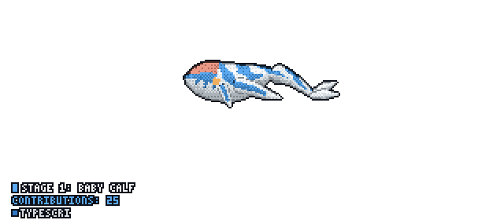

<h1 align="center">Hi there, I'm Atharva 👋</h1>
<h3 align="center">React / TypeScript frontend developer · Python backend developer · based in Pune, India 🇮🇳</h3>

  

  <em>🐋 That's a <a href="https://github.com/PramudithaN/git-tulkun">git-tulkun</a> — it grows and swims based on my GitHub activity.</em> 
  (To make it actually render, add the <code>git-tulkun</code> workflow to this repo — see the link above.)

---

### 🌾 What I'm building

I work on applied AI for agriculture — computer vision, RAG, and satellite data, shipped as real tools for farmers and institutions.

- **🥭 Mango Leaf Disease Detector** — A full-stack web app that identifies mango leaf diseases from a photo. FastAPI backend running an EfficientNetB7 classifier + YOLOv8n for detection, with a React frontend available in English, Hindi, and Marathi.
- **🛰️ NDVI Crop Monitoring Dashboard** — A satellite-based crop health and soil-moisture dashboard built on Google Earth Engine, FastAPI, Postgres, and Leaflet — developed for DBSKKV agricultural research stations.
- **📚 EduSilvaAI** — A full-stack RAG academic assistant for a B.Sc. Forestry/Agroforestry syllabus, combining a Neo4j knowledge graph with ChromaDB vector search, a Java Spring Boot backend, and a React/Vite frontend.
- **🌧️ AI for Konkan Agriculture** — A 7-pillar platform concept pitched to DBSKKV: Alphonso mango AI, weather & extreme-rainfall advisory, pest/disease early-warning, a Marathi voice-first assistant, market intelligence, soil & crop intelligence, and a government command centre — each built as its own standalone app.

---

### 🛠️ Tech stack

  
  
  
  
  
  

  
  
  
  

---

### 📊 GitHub stats

  
  

---

Thanks for stopping by — always building something for Konkan's farms 🌱

